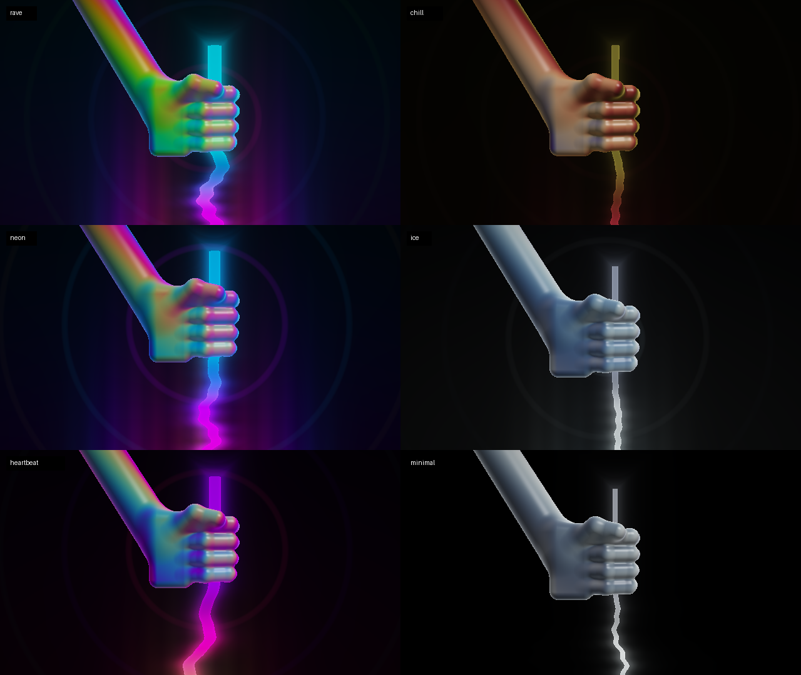
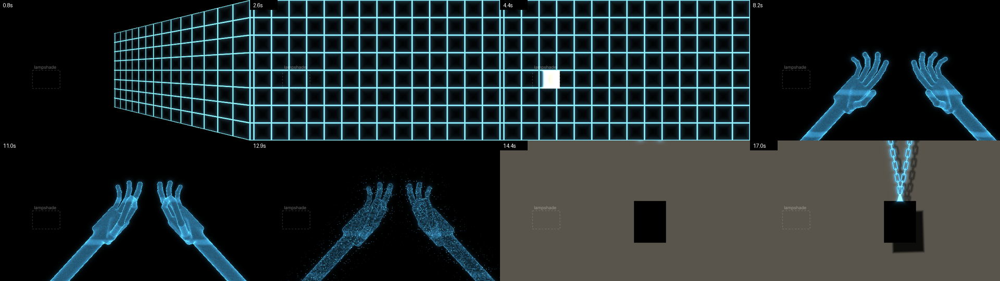

# madmapper-agent

Control [MadMapper](https://madmapper.com) with plain-English instructions. Claude turns an instruction like *"fade the front wall in over 4 seconds"* into OSC messages and sends them to MadMapper over UDP.

```
$ madmapper-agent "fade the front wall in over 4 seconds, then start the intro scene"
  → Faded /surfaces/FrontWall/opacity from 0.00 to 1.00 over 4s
  → Triggered /scenes/Intro/select (1.0)
Faded the front wall up over 4 seconds and triggered the intro scene.
```

## What it can do

| Tool | What it sends |
|---|---|
| `set_opacity` | One value (0–1) to a surface's opacity address |
| `fade` | A linear ramp at 30 steps per second. It blocks until the fade finishes. |
| `trigger` | `1.0` to a button, cue or scene address set in `addresses.json` |
| `apply_preset` | Every parameter of a named visualizer look (see below) |
| `set_parameter` | One shader parameter, named `Material.param` (e.g. `HoloHands.pinch`) |
| `run_show` | A timed show script: fades, parameter ramps and triggers on a timeline |
| `send_raw_osc` | Any address and arguments you give it explicitly |

MadMapper doesn't send values back over this one-way link, so a fade starts from the opposite end (0 when fading up, 1 when fading down) unless you say where it starts, e.g. *"fade the floor from 0.5 down to 0 over 3 seconds"*.

## Setup

1. **Install** (Python 3.10+):
   ```
   pip install -e ".[dev]"
   ```
2. **API key:**
   ```
   export ANTHROPIC_API_KEY=sk-ant-...
   ```
3. **Turn on OSC in MadMapper.** Open Preferences → OSC, enable OSC input, and note the port. Sources disagree on the default (8010 or 8000). This tool uses 8010, so pass `--port` if yours differs.
4. **Fill in `addresses.json`.** MadMapper only responds to addresses that have a matching OSC control. Right-click a parameter in MadMapper, choose **Copy OSC Address**, and paste the address in.
   - `surfaces`: friendly name → surface name (becomes `/surfaces/<Name>/opacity`), or a full opacity address that starts with `/`.
   - `triggers`: friendly name → full OSC address of a button, cue or scene control.
   - `parameter_address_template`: the pattern for shader slider addresses, using `{material}` and `{param}`. Copy the OSC address of any one shader slider and rewrite the template to match; every shader parameter then works. Use the `parameters` section to override individual ones (keyed `Material.param`).
   - Keys that start with `_` are comments and are ignored.
5. **Check your setup:**
   ```
   python scripts/check_setup.py
   ```
   Failures mean the tool won't run. Warnings point at things to fix before a show, such as a missing API key or addresses still at their example values.

## Usage

```
madmapper-agent "hide the left wall"            # one instruction
madmapper-agent                                 # interactive prompt; follow-ups keep context
madmapper-agent --dry-run "blackout"            # log OSC instead of sending
madmapper-agent --host 192.168.1.20 --port 8000 # MadMapper on another machine
madmapper-agent --show koi_frame                # play a show script directly (no Claude, no API key)
```

`--dry-run` still calls Claude (so it needs the API key). It only skips the UDP send.

Options: `--addresses PATH`, `--presets PATH`, `--materials DIR`, `--shows DIR`, `--model` (default `claude-opus-5-5`), `-v` to log every OSC message.

Requests to Claude turn on server-side refusal fallback: if a safety classifier declines a request, the API runs it again on a fallback model within the same call. To turn this off, remove `betas` and `fallbacks` from `MadMapperAgent._create` in `madmapper_agent/agent.py` and switch the call to `client.messages.create`.

## Music visualizer: hand pulling a string

`materials/HandStringVisualizer.fs` is a shader (ISF format, which MadMapper uses for generated visuals). It shows a colorful 3D fist gripping a glowing string:

- **The string is the visualizer.** Each harmonic of the string is driven by one band of the music's spectrum (bass makes long, slow bends; treble makes tight ripples). The raw waveform also ripples along it, and its color brightens where its frequency band is loud.
- **The hand pulls.** It does a slow pulling motion and jerks upward on bass hits.
- **Background.** A spectrum "aurora" rises from the bottom, and rings ripple out from the hand on the beat.



### Load it in MadMapper
1. Drag `materials/HandStringVisualizer.fs` into MadMapper's media list and put it on a surface.
2. Choose your audio input in MadMapper's audio settings. The shader's `waveform` and `spectrum` inputs read from it.
3. Its sliders (Sensitivity, Palette, Glow and so on) appear in MadMapper. To control them with the agent, set `parameter_address_template` in `addresses.json` (see Setup). The template there now is a guess.

### Presets
`presets.json` holds six named looks:

| Preset | Look |
|---|---|
| `chill` | Warm sunset colors, a lazy pull and soft glow |
| `rave` | Fast rainbow cycling, hard bass kicks, a thick bright string |
| `neon` | Magenta and cyan club neon with strong glow |
| `ice` | Cool blues and whites, gentle motion, a thin crisp string |
| `heartbeat` | Barely moves until a bass hit yanks the string |
| `minimal` | Dark background, a single pale string |

Ask for one in plain English (*"go rave"*, *"something calmer"*, *"neon but more glow"*). The agent uses the `apply_preset` and `set_parameter` tools. To add your own preset, copy a block in `presets.json` and change its values. `python scripts/check_setup.py` flags any value outside the shader's range.

Values are sent in the shader's own range (for example, sensitivity 0–4). If a MadMapper slider jumps straight to its maximum, set `"parameter_scale": "normalized"` in `addresses.json` to send 0–1 instead.

### Preview it in a browser
```
python3 -m http.server 8000
```
Then open <http://localhost:8000/preview/>. You can play a demo beat, use your microphone, or play an audio file, and switch presets or move sliders live. Add `?preset=rave` to the address to open on a preset.

## Effects from the reference video: grid, holographic hands, chain

Four shaders and four show scripts recreate a projection-mapping sequence: a grid snaps onto the wall, the lampshade lights up, holographic hands reach in and pinch the picture frame, and a glowing chain drops to "hang" the frame.



### Materials
| Shader | What it draws | Drive it with |
|---|---|---|
| `GridSweep.fs` | A glowing grid that swings in on a hinge and snaps flat onto the surface | `progress` 0→1; `hinge` picks the edge it swings from |
| `SurfaceFill.fs` | Light that wipes across a surface, e.g. switching a lampshade "on" | `progress` 0→1; `direction` |
| `HoloHands.fs` | Two 3D hands made of glowing dots that reach in, pinch, and dissolve into sparks | `reach`, `pinch`, `dissolve` (each 0→1); `target` is the pinch point |
| `ChainHang.fs` | A glowing chain dropping to a clasp on a real picture frame, soft wall light, and a swaying shadow | `drop` 0→1; line `frameCenter`/`frameSize` up with the real frame |
| `IcarusFall.fs` | The whole Icarus Falling scene (below), live in the shader | plays on its own; `speed`, `timeOffset`, `projector`, `glow`, `intensity` |
| `HoloArmLamp.fs` | The whole Holo Arm and Lamp scene (below), live in the shader | plays on its own; same controls as `IcarusFall.fs` |

The first four each have a `loop` checkbox that plays its animation on its own, which is handy while you line things up in MadMapper.

### Show scripts
`shows/*.json` are timelines that play these materials over OSC:

| Show | Length | What happens |
|---|---|---|
| `koi_frame` | 19s | The full sequence |
| `grid_reveal` | 7s | Grid swings in, lampshade lights up, both fade out |
| `holo_hands` | 7s | Hands reach in, pinch, dissolve |
| `chain_hang` | 2s | Chain drops and stays up |

Play one with `madmapper-agent --show koi_frame`, or ask the agent (*"play the hands bit"*). Each step does one thing at a time `at` (seconds):

```json
{"at": 0.0, "opacity": "grid", "to": 1}
{"at": 0.0, "set": "GridSweep.progress", "from": 0, "to": 1, "seconds": 2.4}
{"at": 3.0, "trigger": "intro scene"}
{"at": 4.0, "osc": "/any/address", "args": [1]}
```

With `seconds` a step ramps (30 steps per second); without it, it jumps. A ramp without `from` continues from the value the show last sent. Values are clamped to the shader's ranges. A show that names an unknown surface, trigger or parameter is rejected before anything is sent, and `scripts/check_setup.py` checks every show.

### Set it up in MadMapper
1. Make four surfaces named **Grid**, **Lampshade**, **Hands** and **Chain** (or rename them in `addresses.json`). Map Grid, Hands and Chain over the wall, and Lampshade over the lampshade.
2. Drag the matching `.fs` file onto each surface: GridSweep → Grid, SurfaceFill → Lampshade, HoloHands → Hands, ChainHang → Chain.
3. Turn on `loop` on ChainHang and adjust `frameCenter` and `frameSize` until the clasp sits on your frame's top edge and the black cut-out covers the frame. Do the same with HoloHands' `target`. Then copy those values into the `ChainHang.frameCenter`, `ChainHang.frameSize` and `HoloHands.target` steps of the shows, and turn `loop` off again.
4. Run `madmapper-agent --dry-run --show koi_frame` to see the messages, then run it without `--dry-run`.

### Preview a show in the browser
With `python3 -m http.server 8000` running, open <http://localhost:8000/preview/show.html>. It plays any show with all its layers combined the way a projector adds light, with a timeline you can scrub. Rectangles marked `preview` in each show file set where each surface sits on the stage.

## Scene: holographic arm and lamp

`scenes/holo_arm_lamp.html` is a standalone Three.js piece, a 20-second seamless loop recreating a projection-mapping clip:

1. **Calibration (0–5 s).** A mint grid is keystoned onto the wall corner by corner. A highlight blinks on one cell, lands on the lamp and flashes, and the grid fades from the edges inward.
2. **Orb drop (5–8 s).** A wireframe arm glides in from the top, palm down, carrying a glowing orb. Its fingers open one after another, and the orb falls into the shade and lights it fire orange.
3. **Flame grab (8–11 s).** The hand closes on the shade, its fingertips catching the orange glow. It pulls the flame out as an orb and lifts away, wrist first.
4. **Relight (11–13 s).** The arm swings back down and tosses the orb into the lamp.
5. **Finger gun (13–19 s).** The arm comes in from the right and forms a finger gun. Three shots with wrist recoil send bolts that switch the lamp red, then green, then warm white.
6. **Out (19–20 s).** The hand relaxes and retracts, and the lamp fades off.

Open the file in a browser (it loads three.js 0.160.0 from jsDelivr). Space pauses, R restarts, and 1–6 jump to each beat. Add `?dev` to log FPS, `?t=12` to open paused at a time, and `?hand=procedural` to see the fallback hand.

How it's built:
- The hand is the WebXR generic hand (`right.glb`, MIT, © 2019 Amazon). It loads from jsDelivr, then from a copy embedded in the file, then falls back to a procedural capsule hand with the same 25 joint names. The joints in the model aren't a hierarchy, so the scene runs its own forward kinematics and writes each joint's pose. The forearm and upper arm come from two-bone inverse kinematics, and the upper arm always extends past the edge of the frame.
- Every line is drawn in the shader with `fwidth()` anti-aliasing: a lattice of about 120 cells along the arm, with brighter dots at the intersections. The lattice fades out before its cells get small enough to shimmer. The rim is a tight fresnel term (power 3.5) that whitens at the fingertips.
- Bloom is selective. It only sees thin bright features (rim, orb, lamp emission, grid lines), and it's composited over a sharp full-resolution pass rendered into 4× MSAA targets. That way the wall never blooms and the wireframe stays crisp.
- Authored hex colors are pre-compensated for ACES tone mapping at exposure 1.1, so flat surfaces render at their hex values.
- Motion is a pure function of time. Every move eases with easeInOutCubic, the shoulder leads the elbow by 40 ms and the wrist by 80 ms, and the fingers are staggered 32 ms apart with a ~4° settle overshoot. Orientations blend with quaternion slerp. The hand breathes and its fingers flutter while it's still. The orb follows the hand on a critically damped spring, simulated at a fixed 120 Hz step.

`materials/HoloArmLamp.fs` is the same scene as an ISF material for MadMapper, with the same controls as `IcarusFall.fs` (`speed`, `timeOffset`, `projector`, `glow`, `intensity`). It uses the procedural hand, since a shader can't load the scanned model. Every pixel evaluates the arm for the current time (tracks, two-bone IK, finger forward kinematics) and ray traces the 19 hand capsules, the forearm, the upper arm and the elbow, with the lattice coordinates the browser assigns. The wall, sconce, calibration grid, orb and bolts are drawn analytically. The orb's spring-follow path is sampled at 60 Hz from the browser's own simulation and baked in, as are the hand rig, the poses and the tracks, which use the 16:9 framing (they stay off-screen at other aspect ratios). In projector mode the wall is black and only light is drawn: the lamp's glow on an even wall, the grid, the shade's emission and flame, the arm, the orb and the bolts. It's heavier than `IcarusFall.fs`, so lower the material's resolution if it stutters.

## Scene: Icarus falling

`scenes/icarus_fall.html` uses the same holographic look and is another 20-second seamless loop. Icarus flies too close to a projected sun and falls into a projected sea:

1. **Flight (1–6 s).** He beats feathered wings strapped to his arms and climbs toward the sun. The elbow and wrist lag the shoulder, and the legs trail.
2. **The sun (6–8.5 s).** The sun flares, his rim heats toward orange, wax drips from his wrists, and the outer feathers shiver loose.
3. **Failure (8.5–9.5 s).** The wingbeat speeds up and turns ragged as the feathers tear away, burning orange to red.
4. **The fall (9.5–14.5 s).** He tumbles one and a half turns head over heels, limbs flailing on unrelated rhythms, swings toward the viewer, and straightens into a dive.
5. **The sea (14.5–20 s).** He plunges through the horizon. Spray flies up, perspective ripple rings spread across a wave lattice, and the last feathers drift down.

Same controls as the arm scene (Space, R, 1–6, `?dev`, `?t=`). Add `?projector` to drop the wall and sky glow, leaving pure light on black so unlit areas of the real wall stay dark; record from this mode for MadMapper. The figure is procedural: 21 joints of tapered capsules, skinned with blended weights at the joints. The 24 feathers are instanced vanes with fwidth() outlines, rachis and barbs. Wax drips and spray are crisp instanced discs. The sea is drawn in the wall shader as a log-spaced wave lattice with ripple rings on the water plane.

`materials/IcarusFall.fs` is the same scene as an ISF material, so it runs inside MadMapper with no video file: drag it into the media list and put it on a surface. It loops every 20 seconds on its own. `speed` scales time, `timeOffset` picks where the loop starts, `projector` (on by default) keeps everything but the light black, and `glow` and `intensity` set the bloom and the overall brightness. Every pixel works out the pose for the current time and ray traces the figure (18 tapered capsules with their lattice and rim, front and back faces), the 24 feather vanes, the wax and the spray, so it needs a reasonable GPU at 1080p; lower the material's resolution in MadMapper if it stutters. Values the browser computes up front (the colors after ACES pre-compensation, the rest pose, each feather's pose when it tears loose, the wax sources and the splash point) are baked into the shader, and the wall at z = 0 hides whatever swings behind it, as in the browser. Bloom is approximated with halos.

## Development

```
pytest
```

The tests cover address lookup, every action, the presets (each value checked against the shader's ranges), every shader header, the show compiler and player (with every bundled show compiled against the example config), a real UDP round trip to a local OSC server, and the agent loop with a scripted fake client. They need no network access or API key.

## Layout

```
madmapper_agent/
  addresses.py   friendly-name lookup (addresses.json)
  osc.py         UDP sender with dry-run mode
  actions.py     set_opacity, fade, trigger, send_raw, presets
  materials.py   reads shader (.fs) inputs and their ranges
  presets.py     presets.json
  shows.py       show scripts: compile and play timelines
  agent.py       tool definitions and the Claude tool-use loop
  cli.py         command-line entry point
materials/       shaders: HandStringVisualizer, GridSweep, SurfaceFill, HoloHands, ChainHang, IcarusFall, HoloArmLamp
shows/           show scripts (timelines)
scenes/          standalone rendered pieces (Three.js)
preview/         browser previews: index.html (one shader), show.html (a show)
scripts/check_setup.py
tests/
addresses.json   example mappings, replace with your own
presets.json     named looks for the visualizer
```
